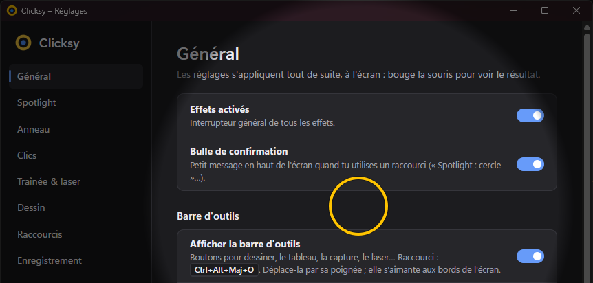
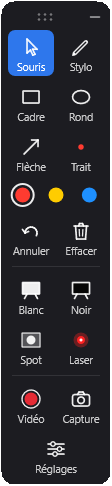
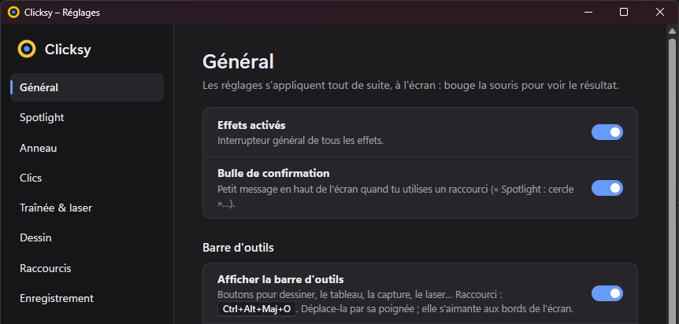

# Clicksy

**Effets de pointeur et enregistrement d'écran pour formateurs, sous Windows 10/11.**
Spotlight, anneau autour du curseur, effets de clic, pointeur laser, dessin à l'écran, tableau blanc
et enregistrement vidéo, pour les tutos e-learning, les démos de logiciels et les classes virtuelles
(Teams, Zoom, Meet).

[](https://github.com/Fr-Groot/clicksy/releases/latest)


🌐 **Site : [fr-groot.github.io/clicksy](https://fr-groot.github.io/clicksy/)**

<p align="center">
  
  &nbsp;
  
</p>

**Aucun appel réseau, aucune télémétrie, aucune touche enregistrée.** Interface en français.
Fichiers non signés pour l'instant : voir [Signature du code](#signature-du-code).

> Version 0.3.0 : enregistrement vidéo de l'écran, d'une fenêtre ou d'une zone, avec le son du PC et le micro. L'éditeur (aperçu, découpe, export avec effets) suivra en 0.4.

<details>
<summary><strong>In English</strong></summary>

**Clicksy** is a free, open-source (MIT) Windows 10/11 app for trainers, teachers and presenters.
It draws effects on top of the screen to guide the audience's attention:

- **Spotlight** (circle or band), **cursor ring**, **click ripples** (left/right colors), **cursor trail**
  and **laser pointer**;
- **On-screen drawing**: pen, rectangle, ellipse, arrow, 3 colors, undo — plus a full-screen
  **whiteboard / blackboard**;
- A floating **toolbar** that never steals focus (PowerPoint stays in slideshow mode) and can be hidden
  from screen sharing and captures;
- **Screen recording** of a screen, window or region, with system audio and microphone, cursor and
  effects included (or recorded separately for a future editor);
- **Screenshots** to PNG and clipboard; global hotkeys; command-line actions for Stream Deck;
- **Key display** for software tutorials (“Ctrl + C”, “Shift + Left click”), hidden in password fields;
- **Profiles** (Tutorial, Virtual class, Stream, Software demo, or your own) applied in one click, and
  **sessions** that keep screenshots, board images and videos together, sorted by course;
- A **video editor** (trim, cut, automatic zoom on clicks, mixed sound, MP4 export) and a **step-by-step
  guide** that turns each click into an illustrated, printable step (HTML / PDF).

It makes no network connections, has no telemetry and never stores keystrokes. The interface is in
**French and English** (it follows the Windows language, or choose in Settings › General). Download the MSI installer or portable ZIP from the
[latest release](https://github.com/Fr-Groot/clicksy/releases/latest). Bug reports and ideas are welcome
in [Issues](https://github.com/Fr-Groot/clicksy/issues), in English or French.

</details>

## Aperçu

| Fenêtre de réglages | Barre d'outils |
|---|---|
|  |  |

Tout s'applique en direct : bouger un curseur de réglage modifie l'effet à l'écran pendant le
glissement. La barre d'outils donne accès au dessin, au tableau, à la capture, au laser, au spotlight
et à l'enregistrement vidéo sans retenir de raccourci.

## Installer

Deux versions, à télécharger dans l'onglet **Releases** du dépôt :

| Version | Pour qui | Droits admin |
|---|---|---|
| `Clicksy_x.y.z_x64_fr-FR.msi` | PC d'entreprise, déploiement Intune / SCCM | Oui, à l'installation seulement |
| `Clicksy-x.y.z-portable.zip` | Test rapide, clé USB, PC verrouillé | Non |

- **MSI** : installe dans `C:\Program Files\Clicksy`, ajoute Clicksy au menu Démarrer et se désinstalle
  depuis Paramètres › Applications. Les réglages vont dans `%APPDATA%\Clicksy`.
  Installation silencieuse : `msiexec /i Clicksy_0.3.0_x64_fr-FR.msi /qn`.
- **Portable** : dézipper puis lancer `clicksy.exe`. Les réglages restent dans le dossier `data\` à côté.

Windows peut afficher « Windows a protégé votre ordinateur » : les binaires ne sont **pas encore signés**
(voir [Signature du code](#signature-du-code)). Cliquer sur *Informations complémentaires › Exécuter quand même*.

WebView2 (fenêtre de réglages) est présent d'office sur Windows 11 et sur la plupart des Windows 10 ;
s'il manque, l'installeur MSI le récupère auprès de Microsoft.

## Utilisation

L'icône (un anneau jaune) apparaît dans la zone de notification, à côté de l'horloge.
**Clic gauche : réglages. Clic droit : menu rapide.** Relancer Clicksy alors qu'il tourne ouvre les réglages.

### Raccourcis par défaut

| Raccourci | Action |
|---|---|
| Ctrl + Alt + Maj + A | Tout activer / désactiver |
| Ctrl + Alt + Maj + S | Spotlight allumé / éteint (forme choisie dans Réglages › Spotlight) |
| Ctrl + Alt + Maj + R | Anneau autour du curseur |
| Ctrl + Alt + Maj + C | Effets de clic |
| Ctrl + Alt + Maj + T | Traînée derrière le curseur |
| Ctrl + Alt + Maj + L | Pointeur laser |
| Ctrl + Alt + Maj + D | Mode dessin |
| Ctrl + Alt + Maj + W | Tableau : blanc → noir → fermé |
| Ctrl + Alt + Maj + P | Capture d'écran (dossier de la session + presse-papiers) |
| Ctrl + Alt + Maj + O | Afficher / masquer la barre d'outils |
| Ctrl + Alt + Maj + E | Enregistrer l'écran de la souris / arrêter l'enregistrement |
| Ctrl + Alt + Maj + K | Afficher les touches pressées |
| Ctrl + Alt + Maj + Y | Profil suivant |
| Ctrl + Alt + Maj + G | Guide pas à pas : démarrer / terminer |

Tous se modifient dans **Réglages › Raccourcis**. Clicksy signale les doublons, les raccourcis déjà pris
par Teams, Office ou Windows, et les combinaisons qui correspondent à AltGr sur un clavier AZERTY.
Une bulle de confirmation (« Spotlight : cercle »…) s'affiche brièvement en haut de l'écran.

### Barre d'outils

Une barre flottante (bord droit par défaut) donne accès à tout sans raccourci : Souris, Stylo, Cadre,
Rond, Flèche, épaisseur du trait, 3 couleurs, Annuler, Effacer, tableau Blanc, tableau Noir, Spot, Laser,
Capture, Touches, Profil, Guide, Réglages, et un petit bouton « réduire » dans la poignée. Les réglages (forme du spotlight, couleurs…)
se choisissent dans la fenêtre Réglages ; la barre sert à les appliquer.

- **Ne prend jamais le focus** : cliquer dessus ne fait pas sortir PowerPoint du diaporama.
- **Déplaçable** par sa poignée (les six points en haut) ; elle s'aimante aux bords gauche/droit et retient sa place.
- **Invisible pour les participants** (option active par défaut) : absente des partages Teams/Zoom/Meet,
  des captures et des enregistrements (Windows 10 version 2004 ou plus récent).
- Les boutons **Blanc** et **Noir** ouvrent le tableau sur l'écran de la souris (re-cliquer le ferme) ; les dessins faits dessus
  sont séparés de ceux de l'écran. « Souris » ferme le tableau et le mode dessin.
- Quand on **efface** ou **ferme** un tableau qui contient des dessins, Clicksy en garde une **image**
  (`Tableau HH-MM-SS.png`) dans le dossier de la session. Désactivable dans Réglages › Dessin.

### Mode dessin

Pendant le mode dessin, les clics servent à dessiner et **ne vont plus à l'application en dessous**.

| Touche | Effet |
|---|---|
| P · R · E · F | Stylo · Cadre · Rond · Flèche |
| Clic droit | Outil suivant |
| 1 · 2 · 3 | Couleurs (réglables) |
| Molette | Épaisseur du trait |
| Maj (pendant le tracé) | Carré, cercle, flèche alignée à 45° |
| Ctrl + Z | Annuler la dernière forme |
| Suppr | Tout effacer |
| Échap | Tout effacer ; s'il n'y a plus rien, quitter le mode dessin |

### Afficher les touches

Bouton **Touches** de la barre, ou Ctrl + Alt + Maj + K : les raccourcis utilisés s'affichent en bas de
l'écran, comme des touches de clavier (« Ctrl + C », « Alt + Tab », « Maj + Clic gauche », « Ctrl + Molette ↑ »).
Une combinaison répétée affiche « ×2 », « ×3 »…

- **Raccourcis seulement** (par défaut) : combinaisons avec Ctrl, Alt ou Win, F1 à F12, Échap. Le texte tapé n'apparaît pas.
- **Toutes les touches** : le texte aussi, sauf quand le champ actif est un mot de passe (« Saisie masquée »,
  détecté par UI Automation ; en cas de doute, Clicksy masque).
- AltGr (@, #, € en AZERTY) n'est pas pris pour un raccourci ; les raccourcis de Clicksy ne s'affichent pas.
- Rien n'est écrit sur le disque : les touches restent affichées quelques secondes, puis sont oubliées.
  Elles apparaissent dans les vidéos en mode incrusté, jamais sur les captures d'écran.

### Sessions

Tout ce qui est enregistré pendant une séance va dans **un seul dossier** :
`Documents\Clicksy\AAAA-MM-JJ HHhMM\` (captures, images du tableau, et un sous-dossier `Vidéo HH-MM-SS` par
enregistrement). Une session commence au lancement de Clicksy et chaque jour ; **Menu › Nouvelle session**
(ou le bouton des Réglages) en ouvre une autre. Le dossier n'est créé qu'au premier élément enregistré.
Désactivable dans Réglages › Général : on retrouve alors `Images\Clicksy` et `Vidéos\Clicksy`.

**Formation en cours** (Réglages › Général, ou **Menu › Formation**) : les sessions sont alors rangées
dans un sous-dossier à son nom, `Documents\Clicksy\Excel niveau 1\2026-11-09 14h30\`. Les dix dernières
formations restent proposées dans le menu. Changer de formation ouvre une nouvelle session.

### Profils

Un profil regroupe les réglages des effets, du dessin, des touches et de l'enregistrement pour un usage.
Quatre sont proposés d'origine :

| Profil | Réglages |
|---|---|
| Tuto | Touches affichées, son de clic, souris incrustée dans la vidéo |
| Classe virtuelle | Anneau qui pulse, clics, sans son ni touches |
| Stream | Traînée, pas d'anneau ni de bulles, vidéo à 60 i/s |
| Démo logiciel | Spotlight cercle allumé, touches affichées |

On applique un profil avec le bouton **Profil** de la barre d'outils, **Menu › Profil**, ou Ctrl + Alt + Maj + Y
(profil suivant). Dans **Réglages › Profils** : créer un profil à partir des réglages actuels, le mettre à jour,
le renommer ou le supprimer. Les raccourcis, la barre d'outils et les dossiers ne font pas partie des profils.

### Langue

Français ou anglais pour les menus, la barre d'outils, les bulles, les touches affichées et les réglages.
Par défaut, Clicksy suit la langue de Windows ; **Réglages › Général › Langue** permet de choisir.

### Enregistrement vidéo

Bouton **Vidéo** de la barre d'outils : écran entier, une fenêtre (clic dessus) ou une zone (tracée à la souris),
avec le son du PC et le micro (activables dans le même menu). Compte à rebours de 3 secondes, puis le bouton
affiche le chrono ; un clic dessus arrête. Un cadre rouge entoure ce qui est enregistré : toi seul le vois.

**Deux modes** (Réglages › Enregistrement › « Incruster la souris et les effets ») :
- **Incrusté** (par défaut) : la vidéo montre ce que tu vois — souris, anneau, clics, dessins, spotlight,
  tableau. Prête à partager. Seuls la barre d'outils et le cadre rouge restent hors de la vidéo.
- **Éditable** : vidéo filmée *sans* souris ni effets ; le curseur (position, forme) et les clics sont notés
  à part, et l'éditeur redessine la souris à l'export.

Dans les deux cas, le journal du curseur est enregistré, et les touches tapées ne le sont jamais.

Chaque enregistrement crée un dossier `Vidéo HH-MM-SS` dans le dossier de la session :

| Fichier | Contenu |
|---|---|
| `screen.mp4` | Vidéo H.264 (encodeur matériel de Windows) |
| `system.wav`, `mic.wav` | Son du PC et micro, pistes séparées, alignées sur la vidéo |
| `events.jsonl` | Positions et formes du curseur, clics, molette (horodatés) |
| `cursors\` | Images des formes de curseur rencontrées |
| `project.json` | Source, tailles, horloges |

Limites : pas encore de pause ; un contenu protégé (vidéo sous DRM) apparaît en noir ; en mode éditable,
les effets Clicksy ne sont pas visibles non plus dans un partage Teams simultané.

### Éditeur vidéo

À la fin d'un enregistrement, la vidéo s'ouvre dans l'**éditeur** (désactivable dans Réglages › Enregistrement ;
aussi dans le menu du bouton Vidéo et **Menu › Éditeur vidéo…**). La liste en haut donne accès à tous les
enregistrements, rangés par formation et par session.

- **Couper** : les poignées jaunes de la frise règlent le début et la fin ; glisser dans la frise sélectionne un
  passage, puis « Couper ce passage ». Un passage coupé se rétablit en le sélectionnant.
- **Zooms** : proposés automatiquement sur les clics (points jaunes de la frise). Un zoom se déplace et
  s'allonge dans la frise ; on règle son grossissement et son centre (« Placer le centre », puis clic dans l'image).
  « Zoomer sur ce passage » en ajoute un.
- **Son** : volume du son du PC et du micro.
- **Exporter la vidéo** : `Vidéo finale.mp4` dans le dossier de l'enregistrement, avec la zone choisie, les coupes,
  les zooms (transitions douces), le son mixé et, en mode éditable, la souris redessinée. Les réglages sont
  gardés dans `edit.json` : on peut rouvrir et réexporter.

Raccourcis de l'éditeur : Espace (lecture), ← → (1 seconde), Suppr (supprimer la sélection).

### Guide pas à pas

Bouton **Guide** de la barre d'outils (ou Ctrl + Alt + Maj + G) : chaque clic devient une **étape illustrée**,
décrite automatiquement grâce à l'accessibilité de Windows (« Cliquer sur le bouton « Enregistrer » »,
« Cliquer sur l'onglet « Accueil » »). Les raccourcis deviennent des étapes (« Appuyer sur Ctrl + S ») ;
le texte tapé est signalé (« Saisir le texte voulu ») **sans jamais être noté**. Les double-clics sont reconnus.

Re-cliquer sur **Guide** termine : la page `Guide.html` s'ouvre dans le navigateur, dans un dossier `Guide HH-MM-SS`
de la session. Chaque étape montre l'écran en gros plan autour du clic, avec un repère rouge (clic sur l'image :
écran entier). Les textes sont modifiables avant d'imprimer ou d'**enregistrer en PDF**.

### Ligne de commande (Stream Deck, scripts)

Avec Clicksy déjà lancé, `clicksy.exe --action <nom>` déclenche une action :
`tout`, `spotlight`, `anneau`, `clics`, `trainee`, `laser`, `dessin`, `pulsation`, `son`,
`tableau`, `blanc`, `noir`, `capture`, `barre`, `video`, `touches`, `session` (nouvelle session), `profil` (profil suivant), `editeur`, `guide`.
Pratique pour un bouton Stream Deck (action « Ouvrir » avec ces arguments).

## Test manuel

| # | Étapes | Résultat attendu |
|---|---|---|
| 1 | Lancer Clicksy | L'icône apparaît en moins de 2 s ; l'anneau jaune suit le curseur |
| 2 | Cliquer gauche, puis droit | Onde bleue (gauche) ou rouge (droit) ; le clic **atteint bien l'app en dessous** |
| 3 | Maintenir le bouton gauche | Pastille tant que le bouton est enfoncé ; le glisser-déposer fonctionne |
| 4 | Réglages › Spotlight › Forme « Bande horizontale », puis Ctrl + Alt + Maj + S deux fois | Bande allumée puis éteinte ; bulle de confirmation à chaque fois |
| 5 | Taper dans Word ou Notepad pendant le test 4 | La lettre S n'est jamais tapée ; les raccourcis Office/Teams marchent toujours |
| 6 | Menu › Pulsation de l'anneau | L'anneau « respire » doucement |
| 7 | Menu › Son de clic, puis cliquer | Petit « clic » sec à chaque appui |
| 8 | PowerPoint › diaporama (F5) | Les effets restent visibles par-dessus le diaporama |
| 9 | Teams › partager **l'écran entier** | Les participants voient les effets |
| 10 | 2 écrans à 100 % et 150 % — *non testé, faute de 2ᵉ écran* | Effets sur les deux écrans, même taille apparente |
| 11 | Changer l'échelle (Paramètres › Affichage) | La surcouche se recrée ; les effets gardent leur taille apparente |
| 12 | Gestionnaire des tâches, souris immobile | CPU ≈ 0 % (mesuré : 0,3 à 0,65 %) |
| 13 | Clic gauche sur l'icône | Réglages ouverts en moins d'une seconde, thème clair ou sombre comme Windows |
| 14 | Réglages › Spotlight › Cercle, glisser « Taille du cercle » | Le cercle change **pendant** le glissement |
| 15 | Réglages › Raccourcis, taper Ctrl + Maj + M | Avertissement « déjà utilisé par Teams (micro) » |
| 16 | Ctrl + Alt + Maj + T, bouger la souris | Une traînée suit le curseur puis s'efface |
| 17 | Ctrl + Alt + Maj + L | Point rouge lumineux avec traînée ; l'anneau disparaît. Rappuyer : retour normal |
| 18 | Ctrl + Alt + Maj + D, puis dessiner avec P, R, E, F | Stylo lissé, cadre, rond, flèche ; les clics ne vont pas à l'app dessous |
| 19 | En mode dessin : 2, molette, Maj pendant un cadre | Couleur 2, trait plus épais, carré parfait |
| 20 | En mode dessin : Ctrl + Z, puis Échap deux fois | Dernière forme retirée ; tout effacé ; mode dessin quitté |
| 21 | Fermer les réglages, quitter et relancer | Effets actifs après fermeture ; réglages conservés |
| 22 | `clicksy.exe --action laser` | Le laser s'allume dans l'instance déjà lancée |
| 23 | MSI : installer, lancer depuis le menu Démarrer, désinstaller | Installation dans Program Files ; désinstallation propre ; réglages dans `%APPDATA%\Clicksy` |
| 24 | Barre d'outils : Stylo, dessiner, puis Souris | Le dessin marche ; « Souris » rend les clics aux applis |
| 25 | PowerPoint en diaporama, cliquer sur des boutons de la barre | Le diaporama reste au premier plan et répond toujours aux flèches du clavier |
| 26 | Glisser la barre par sa poignée vers le bord gauche, relancer Clicksy | Elle s'aimante au bord gauche et y revient au redémarrage |
| 27 | Teams : partager l'écran entier, regarder depuis un 2ᵉ appareil | Les effets sont visibles, la barre d'outils **ne l'est pas** |
| 28 | Bouton Blanc, dessiner, bouton Noir, re-cliquer Noir | Blanc puis noir plein écran (mêmes dessins) ; fermé au 2ᵉ clic, les dessins de l'écran reviennent |
| 29 | Bouton Capture | Bulle « Capture enregistrée et copiée » ; fichier PNG dans le dossier de la session ; collable dans Word ou Teams |
| 30 | Bouton Vidéo › Enregistrer l'écran entier, parler, bouger la souris, re-cliquer Vidéo | Compte à rebours 3-2-1, chrono dans la barre, cadre rouge ; à l'arrêt, dossier ouvert avec `screen.mp4` lisible, `mic.wav` audible |
| 31 | Lire `screen.mp4` (mode incrusté par défaut) | La souris, l'anneau, les clics et les dessins sont dans la vidéo ; la barre d'outils n'y est pas |
| 32 | Bouton Vidéo › Enregistrer une fenêtre…, cliquer sur une fenêtre | Seule cette fenêtre est filmée, même si on la déplace |
| 33 | Bouton Vidéo › Enregistrer une zone…, tracer un rectangle | Dimensions affichées pendant le tracé ; cadre rouge autour de la zone pendant l'enregistrement |
| 34 | Pendant le choix de la source, Échap ou clic droit | « Enregistrement annulé » |
| 35 | Jouer une vidéo YouTube pendant un enregistrement | `system.wav` contient le son, synchronisé avec l'image |
| 36 | Bouton Touches, puis Ctrl + C, Alt + Tab, Ctrl + Z trois fois | « Ctrl + C », « Alt + Tab », puis « Ctrl + Z ×3 » en bas de l'écran ; le texte tapé n'apparaît pas |
| 37 | Réglages › Touches › « Toutes les touches », taper dans Notepad puis dans un champ mot de passe (connexion Windows d'un site, coffre…) | Les lettres s'affichent dans Notepad ; « Saisie masquée » dans le champ mot de passe |
| 38 | Clavier AZERTY : AltGr + 0 dans Notepad | « @ » est tapé ; rien ne s'affiche en mode « Raccourcis seulement » |
| 39 | Maj + clic, Ctrl + molette dans le navigateur | « Maj + Clic gauche », « Ctrl + Molette ↑ » |
| 40 | Bouton Blanc, dessiner, Effacer, dessiner, re-cliquer Blanc | Deux images `Tableau …png` dans le dossier de la session, sans pointeur ni bulle ; « Tableau fermé · image enregistrée » |
| 41 | Capture, puis vidéo de quelques secondes | Capture et dossier `Vidéo …` dans le même dossier `Documents\Clicksy\<date heure>` |
| 42 | Menu › Nouvelle session, puis Capture | Nouveau dossier de session |
| 43 | Réglages › Général › Langue › English | Réglages, menu de l'icône, barre d'outils et bulles en anglais ; touches affichées « Shift », « Enter » |
| 44 | Langue « Auto » sur un Windows en anglais | Clicksy démarre en anglais |
| 45 | Bouton Profil de la barre › Stream | Bulle « Profil : Stream » ; traînée allumée, anneau éteint ; le profil est coché dans le menu |
| 46 | Ctrl + Alt + Maj + Y plusieurs fois | Les profils défilent dans l'ordre |
| 47 | Réglages › Profils : changer une couleur, « Mettre à jour », appliquer un autre profil puis revenir | La couleur modifiée revient avec le profil |
| 48 | Réglages › Profils : créer « Mon profil », le renommer, le supprimer | La barre et le menu suivent ; supprimer tous les profils fait revenir ceux d'origine |
| 49 | Réglages › Général › Formation « Excel niveau 1 » › Valider, puis Capture | Fichier dans `Documents\Clicksy\Excel niveau 1\<date heure>\` ; la formation apparaît dans Menu › Formation |
| 50 | Menu › Formation › Aucune formation, puis Capture | Nouvelle session directement dans `Documents\Clicksy\` |
| 51 | Enregistrer 20 s en cliquant à plusieurs endroits, arrêter | L'éditeur s'ouvre sur cette vidéo ; des zooms sont proposés sur les clics |
| 52 | Éditeur : lecture | Les zooms se font en douceur ; le son du PC et le micro suivent l'image |
| 53 | Éditeur : déplacer les poignées jaunes, sélectionner un passage › Couper ce passage | « Vidéo finale » raccourcit ; la lecture saute le passage |
| 54 | Éditeur : cliquer un zoom › Grossissement 250 % › Placer le centre › clic dans l'image | Le zoom vise le nouvel endroit |
| 55 | Éditeur : Exporter la vidéo, puis Lire | `Vidéo finale.mp4` reprend coupes, zooms et son |
| 56 | Enregistrement en mode éditable (incrustation désactivée), puis export | La souris est redessinée dans `Vidéo finale.mp4` |
| 57 | Enregistrer une zone, puis exporter | La vidéo finale ne montre que la zone |
| 58 | Bouton Guide, cliquer 3 boutons d'une appli, Ctrl + S, taper du texte, re-cliquer Guide | Page ouverte dans le navigateur : 3 étapes illustrées avec le nom des boutons, « Appuyer sur Ctrl + S », « Saisir le texte voulu » (sans le texte) |
| 59 | Guide : modifier un texte, Imprimer ou enregistrer en PDF | PDF propre, sans bouton ni encadré d'aide |
| 60 | Guide : double-clic sur un fichier | Étape « Double-cliquer sur « … » » |

## Limites Windows connues

- **Applis lancées en administrateur** : l'anneau et le spotlight suivent la souris, mais les clics,
  les raccourcis et le dessin ne fonctionnent pas tant qu'une app admin a le focus (isolation UIPI).
  La version MSI **signée** avec `uiAccess` lèvera cette limite.
- **Menu Démarrer, Alt+Tab, centre de notifications** : peuvent passer au-dessus des effets (même raison).
- **Écran UAC, Ctrl+Alt+Suppr, écran de verrouillage** : aucun effet possible (bureau sécurisé).
- **Jeux en plein écran exclusif** : surcouche invisible (les jeux en fenêtre sans bordure fonctionnent).
- **Partage d'une seule fenêtre** dans Teams/Zoom : les effets ne sont pas transmis (partager l'écran entier).

## Signature du code

**Les fichiers de Clicksy ne sont pas signés pour l'instant.** Windows SmartScreen peut donc afficher un
avertissement, et certains PC d'entreprise bloquent leur exécution.

- **En entreprise**, le service informatique peut autoriser le MSI, ou le signer avec l'autorité de
  certification interne de l'entreprise (certificat déployé par GPO ou Intune). Le code source et le
  workflow de construction (GitHub Actions) sont publics pour qu'il puisse les vérifier.
- Une signature publique (programme open source de SignPath Foundation, ou certificat Certum Open Source)
  sera envisagée quand le projet sera plus largement utilisé.

Seuls les fichiers construits par le workflow GitHub Actions public de ce dépôt, à partir de son code
source, sont publiés dans les releases. Les sommes SHA256 de chaque fichier sont dans `SHA256SUMS.txt`.

### Privacy policy

This program will not transfer any information to other networked systems unless specifically
requested by the user or the person installing or operating it.

*Clicksy n'envoie aucune information sur le réseau. Il n'a ni télémétrie ni mise à jour automatique,
et les touches frappées ne sont jamais enregistrées. Seule exception : si WebView2 manque, l'installeur
MSI le télécharge auprès de Microsoft.*

Une fois signé, le MSI pourra aussi activer `uiAccess` (premier plan au-dessus des apps admin).

## Compiler

Prérequis : Rust (toolchain `stable-x86_64-pc-windows-msvc`) et les Build Tools Visual Studio (C++).

```bash
cargo build --release
```

`target/release/clicksy.exe` est la version portable. Pour le MSI :

```bash
cargo install tauri-cli --version "^2" --locked
cd app && cargo tauri build
```

Le MSI sort dans `target/release/bundle/msi/`. Le workflow GitHub Actions (`.github/workflows/release.yml`)
produit les deux versions et les publie à chaque tag `v*`.

## Architecture

```
app/              exe : icône de notification, moteur, réglages (Tauri v2), ligne de commande
ui/               interface des réglages (HTML/CSS/JS, sans étape de build, polices système)
crates/fx-bus     bus d'événements typé et horodaté (base du futur journal JSON)
crates/fx-core    config JSON, raccourcis, chemins portables, état partagé (pur Rust)
crates/fx-input   hooks WH_MOUSE_LL / WH_KEYBOARD_LL sur un thread dédié
crates/fx-overlay une fenêtre par écran, rendu D3D11 + Direct2D + DirectComposition + DirectWrite
crates/fx-audio   son de clic synthétisé en mémoire
crates/fx-record  enregistrement : vidéo (windows-capture, MIT), son (wasapi, MIT), journal du curseur
```

Threads : principal (Tauri), icône, hooks, moteur, rendu. Le rendu dort tant que rien ne change
et ne redessine que les écrans concernés, au plus une fois par rafraîchissement.

## Licence

MIT. Projet indépendant, sans lien avec d'autres outils d'effets de pointeur.
